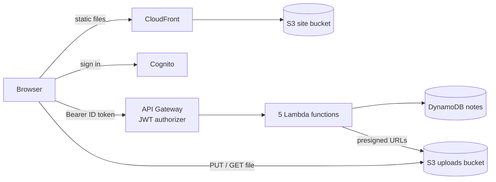

# Serverless Notes

A full-stack serverless notes app on AWS, written in TypeScript end to end. Users sign up and sign in, then create notes with an optional file attachment.

**Stack:** React 19 · Vite 8 · Tailwind CSS 4 · TanStack Query 5 · AWS Amplify Auth 6 · AWS Lambda (Node.js 24, arm64) · API Gateway HTTP API · Cognito · DynamoDB · S3 · CloudFront · Terraform (AWS provider 6) · pnpm workspaces + Turborepo · Vitest · ESLint 10 · TypeDoc



See [docs/ARCHITECTURE.md](docs/ARCHITECTURE.md) for the request flow, data model and security design.

## Repository layout

```
serverless-notes/
├── apps/
│   ├── api/            @notes/api    Lambda handlers (TypeScript → esbuild bundles)
│   └── web/            @notes/web    React single-page app
├── packages/
│   └── shared/         @notes/shared Types, zod schemas and API paths used by both apps
├── infra/terraform/    All AWS infrastructure
├── scripts/            gen-env, deploy-web and smoke-test helpers
├── docs/               Architecture, coding standards, generated API docs (docs/api)
├── eslint.config.js    One lint config for every workspace
├── tsconfig.base.json  Strict compiler options every workspace extends
├── turbo.json          Task pipeline (build, lint, typecheck, test, dev)
└── pnpm-workspace.yaml Workspaces + version catalog
```

## Prerequisites

| Tool      | Version        | Check                         |
| --------- | -------------- | ----------------------------- |
| Node.js   | 24+ (`.nvmrc`) | `node -v`                     |
| pnpm      | via Corepack   | `corepack enable && pnpm -v`  |
| AWS CLI   | v2, configured | `aws sts get-caller-identity` |
| Terraform | 1.10+          | `terraform -version`          |
| jq        | any            | `jq --version` (smoke test)   |

Use a sandbox AWS account and set a budget alert. Everything is pay-per-use and close to free at learning volume.

## Quick start

```bash
corepack enable          # once per machine: provides the pinned pnpm version
pnpm install

pnpm infra:init          # terraform init
pnpm infra:apply         # bundle the Lambdas, then create everything in AWS (~5 min)
pnpm test:smoke          # test auth + API + DynamoDB + S3 from the CLI
pnpm env:web             # write apps/web/.env.local from Terraform outputs
pnpm dev                 # run the React app at http://localhost:5173
```

Publish the frontend to CloudFront:

```bash
pnpm deploy:web          # build, upload to S3, invalidate CloudFront, print the URL
```

## Scripts

| Command              | What it does                                                 |
| -------------------- | ------------------------------------------------------------ |
| `pnpm dev`           | Vite dev server for the web app                              |
| `pnpm build`         | Build every workspace (Lambda bundles + web app)             |
| `pnpm lint`          | ESLint in every workspace                                    |
| `pnpm typecheck`     | `tsc --noEmit` in every workspace                            |
| `pnpm test`          | Vitest unit tests in every workspace                         |
| `pnpm check`         | Format check + lint + typecheck + test + build (same as CI)  |
| `pnpm format`        | Format everything with Prettier                              |
| `pnpm docs:build`    | Generate the API reference from JSDoc/TSDoc into `docs/api/` |
| `pnpm infra:plan`    | Build Lambdas, then `terraform plan`                         |
| `pnpm infra:apply`   | Build Lambdas, then `terraform apply`                        |
| `pnpm infra:destroy` | Delete every AWS resource this project created               |
| `pnpm env:web`       | Generate `apps/web/.env.local` from Terraform outputs        |
| `pnpm deploy:web`    | Build and publish the web app to S3 + CloudFront             |
| `pnpm test:smoke`    | End-to-end test against the deployed API                     |

Run a task in one workspace with a filter, for example `pnpm --filter @notes/api test`.

## API

| Route                | Handler        | Purpose                                       |
| -------------------- | -------------- | --------------------------------------------- |
| `POST /notes`        | `createNote`   | Create a note, optionally with an attachment  |
| `GET /notes`         | `listNotes`    | List the signed-in user's notes, newest first |
| `GET /notes/{id}`    | `getNote`      | One note plus a 5-minute download URL         |
| `DELETE /notes/{id}` | `deleteNote`   | Delete the note and its attachment            |
| `POST /uploads`      | `getUploadUrl` | Presigned URL to PUT a file straight to S3    |

Every route requires `Authorization: Bearer <Cognito ID token>`. Request and response types live in [`packages/shared`](packages/shared/README.md).

## Documentation

- [Architecture](docs/ARCHITECTURE.md): request flow, auth, data model, security.
- [Coding standards](docs/CODING_STANDARDS.md): conventions and what the tooling enforces.
- API reference: run `pnpm docs:build`, then open `docs/api/index.html`. It is generated from the JSDoc comments on every exported function, component, type and handler.

## Testing

- **Unit tests** (`pnpm test`): handlers are tested against mocked AWS SDK clients (`aws-sdk-client-mock`), React components with Testing Library, and shared schemas directly.
- **Smoke test** (`pnpm test:smoke`): creates a confirmed Cognito user, checks that anonymous calls get 401, uploads to S3 through a presigned URL, and creates, lists, reads and deletes a note.
- **Logs:** `aws logs tail /aws/lambda/serverless-notes-dev-createNote --follow` (JSON-formatted).

## Troubleshooting

| Symptom                                        | Fix                                                                                      |
| ---------------------------------------------- | ---------------------------------------------------------------------------------------- |
| 401 although signed in                         | Send the **ID** token (it has `aud`), not the access token                               |
| Web app says configuration is missing          | Run `pnpm env:web` and restart `pnpm dev`                                                |
| `terraform plan` says a dist folder is missing | Run `pnpm infra:plan`, which builds the Lambdas first, instead of plain `terraform plan` |
| S3 upload returns 403 SignatureDoesNotMatch    | Upload with the same `Content-Type` that was sent to `/uploads`                          |
| 500 from the API                               | Read the function's CloudWatch log; stack traces map to the TypeScript source            |

## Cleanup

```bash
pnpm infra:destroy
```

Buckets use `force_destroy`, so they are emptied automatically. Cognito users are removed with the pool.
